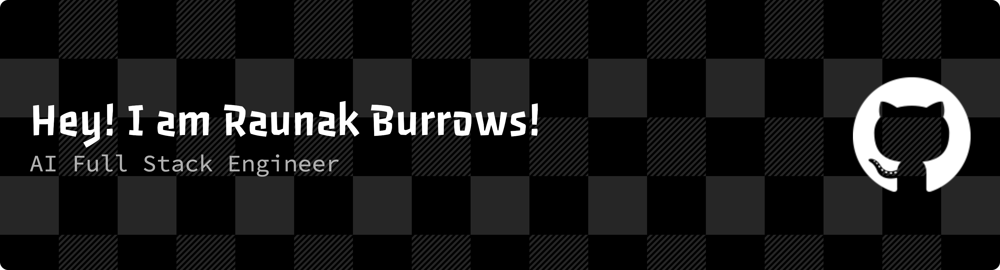

<table>
<tr>
<td width="27%" align="center" valign="top">

</td>
<td width="73%" valign="top">

**AI and agent engineer in London.** I build agentic systems that ship to production: multi-agent orchestration, MCP servers, and the eval pipelines that keep them honest, in Go, Python and TypeScript.

- Currently a tech lead in an **AI Products & Platform** team
- **MSc AI, University of Surrey (Merit)**: my dissertation cut NHS doctor wait times by 58% with a Mixture-of-Agents
- Off-keyboard: chess, piano, guitar, drums, and a sketchbook
- Reach me at **raunakburrows@gmail.com**

</td>
</tr>
</table>

  &nbsp;
  &nbsp;
  &nbsp;
  &nbsp;
  

---

### Open source

I have [**30+ merged pull requests**](https://github.com/search?type=pullrequests&q=is%3Apr+author%3Aburrows99+is%3Amerged+repo%3Awindmill-labs%2Fwindmill+repo%3Akubernetes-sigs%2Fkueue+repo%3Ahuggingface%2Ftransformers+repo%3Allm-d%2Fllm-d-inference-sim+repo%3Agoogle%2Fadk-go+repo%3An8n-io%2Fn8n+repo%3Atwentyhq%2Ftwenty+repo%3Agpustack%2Fgpustack+repo%3Aaaif-goose%2Fgoose) across nine projects in agent, workflow and ML infrastructure. Most of them are bug fixes.

| Project | Merged | Highlights |
|---|:-:|---|
| [Windmill](https://github.com/windmill-labs/windmill/pulls?q=is%3Apr+author%3Aburrows99+is%3Amerged) | 14 | [Folder write-permission prefix bug](https://github.com/windmill-labs/windmill/pull/12450) · [UTF-8 webhook GET payloads](https://github.com/windmill-labs/windmill/pull/12453) · [Clearing a variable's value](https://github.com/windmill-labs/windmill/pull/12466) |
| [Kubernetes Kueue](https://github.com/kubernetes-sigs/kueue/pulls?q=is%3Apr+author%3Aburrows99+is%3Amerged) | 5 | [ResourceFlavor that fits the Pod in the Pod importer](https://github.com/kubernetes-sigs/kueue/pull/18977) · [Truncated names ending in a dot](https://github.com/kubernetes-sigs/kueue/pull/18803), backported to [release-0.20](https://github.com/kubernetes-sigs/kueue/pull/18959) and [0.19](https://github.com/kubernetes-sigs/kueue/pull/18960) at a maintainer's request |
| [Hugging Face Transformers](https://github.com/huggingface/transformers/pulls?q=is%3Apr+author%3Aburrows99+is%3Amerged) | 4 | [Multimodal pipelines return the chat as `input_text`](https://github.com/huggingface/transformers/pull/50816) · [Docs imports that failed on main](https://github.com/huggingface/transformers/pull/50817) |
| [llm-d inference-sim](https://github.com/llm-d/llm-d-inference-sim/pulls?q=is%3Apr+author%3Aburrows99+is%3Amerged) | 2 | [Streamed `/v1/responses` event numbering](https://github.com/llm-d/llm-d-inference-sim/pull/917) · [Empty `top_logprobs` in chat logprobs](https://github.com/llm-d/llm-d-inference-sim/pull/918) |
| Google ADK (Go) | 1 | [Redact and bound code-part labels in agent analytics](https://github.com/google/adk-go/pull/2332) |
| n8n | 1 | [Discord node keeps the original error](https://github.com/n8n-io/n8n/pull/43943) |
| Twenty | 1 | [API key expiry label in the last 24 hours](https://github.com/twentyhq/twenty/pull/30462) |
| GPUStack | 1 | [Reconnected worker keeps its tunnel route](https://github.com/gpustack/gpustack/pull/6795) |
| goose | 1 | [Ollama XML tool calls keep `<think>` tags](https://github.com/aaif-goose/goose/pull/13563) |

I also merged an earlier [prototype-pollution fix in StackOne Defender](https://github.com/StackOneHQ/defender/pull/47). Open and in review: [awslabs/stickler](https://github.com/awslabs/stickler/pull/582) (approved), [NVIDIA Warp](https://github.com/NVIDIA/warp/pull/2339), [vLLM Semantic Router](https://github.com/vllm-project/semantic-router/pull/6848) and [Qwen Code](https://github.com/QwenLM/qwen-code/pull/17461).

### What I build

- **Agentic systems**: supervisor/worker multi-agent graphs in LangGraph, semantic routing, and tool execution that's safe against real systems of record
- **MCP servers**: typed clients that agents, humans and scripts all drive through one interface
- **Evals**: LLM-as-a-judge, golden datasets, and prompt regression tests
- **Stack**: Go, Python (FastAPI), TypeScript (React, Next.js, NestJS), PostgreSQL, Docker, Kubernetes, AWS

### Things I've built

- [**witness**](https://github.com/macquery-labs/witness) drives and debugs a running app from one config file, then hands back a video a person can watch and a report an agent can read
- [**nhs-triage-simulation**](https://github.com/burrows99/nhs-triage-simulation) is my MSc dissertation: a Mixture-of-Agents triage simulation built with SimPy, LangGraph and FHIR synthetic data
- [**goroutine-lab**](https://github.com/burrows99/goroutine-lab) teaches Go concurrency with 27 real patterns run in slow motion, which you step through like a debugger
- [**Chat-Playwright**](https://github.com/burrows99/Chat-Playwright) does chat-driven browser automation with LibreChat, Ollama and the Playwright MCP server
- [**solar_system**](https://github.com/burrows99/solar_system) is an interactive solar-system simulation with realistic orbits and scale

<!-- Snake animation eating the contribution grid (auto-built by the Platane/snk Action) -->

  <picture>
    <source media="(prefers-color-scheme: dark)" srcset="https://raw.githubusercontent.com/burrows99/burrows99/output/github-contribution-grid-snake-dark.svg" />
    
  </picture>

